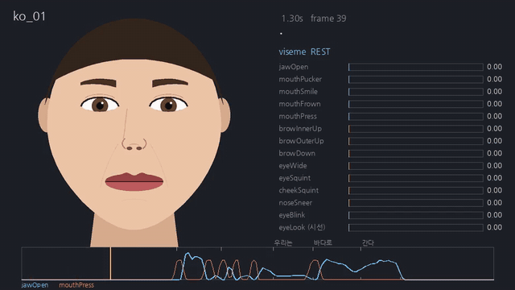
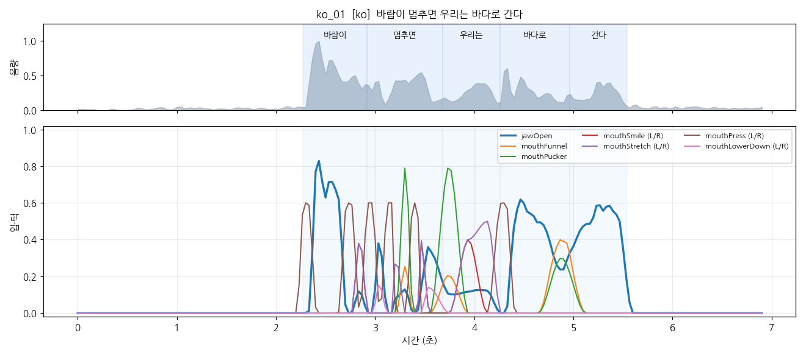
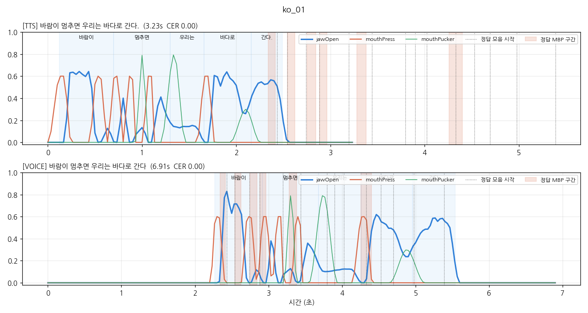
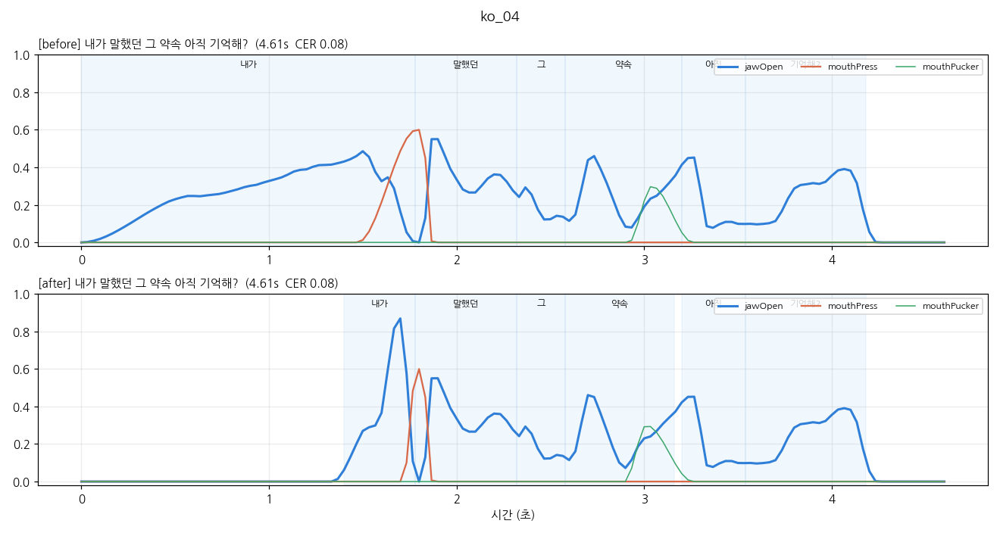
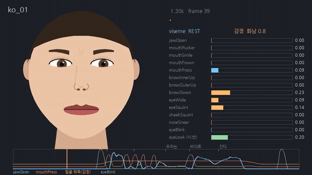
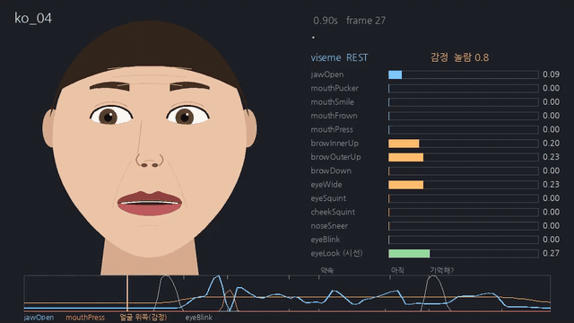
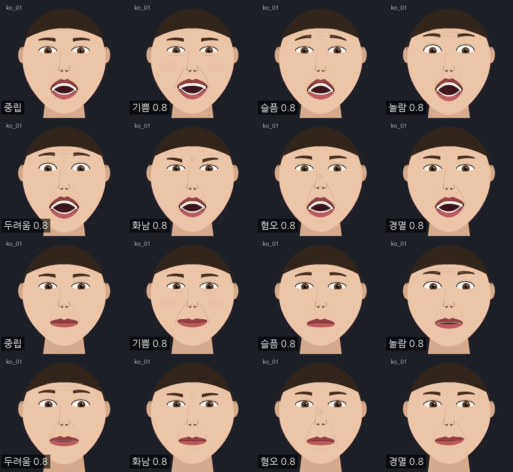
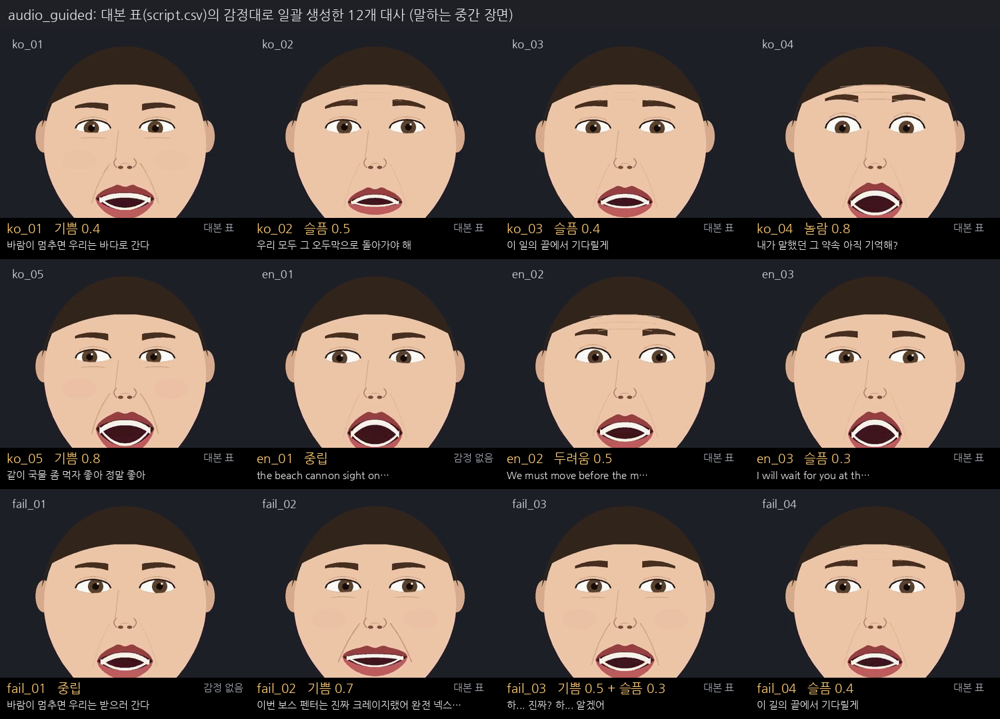
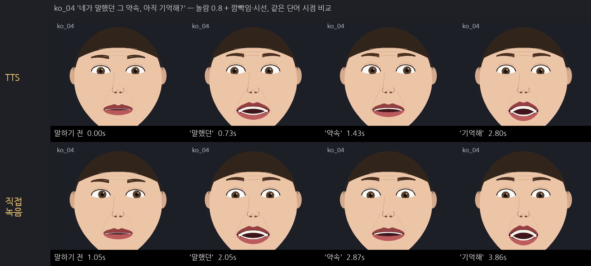

# lipsync-poc — 음성 기반 자동 페이셜 립싱크 데이터 생성기

성우 대사 음성(.wav)을 넣으면 **ARKit 52 블렌드쉐입 키프레임(30fps JSON/CSV)**을 자동 생성해,
수작업 립싱크 키잉 시간을 줄이는 PoC입니다. 한국어(메인)와 영어를 지원합니다.

> 부트캠프 과제 "Main Quest 2. 내 도메인에서 AI로 개선 지점 찾아서 PoC 만들기" 제출물

[](https://colab.research.google.com/github/benjy89a/Lip-sync/blob/main/notebooks/lipsync_poc_colab.ipynb)

## 시연

직접 녹음한 대사 "바람이 멈추면 우리는 바다로 간다."에서 자동 생성한 결과입니다 (2D 입모양 미리보기).



소리가 포함된 영상: [ko_01](outputs/showcase/ko_01_voice_preview.mp4) · [ko_05](outputs/showcase/ko_05_voice_preview.mp4) · [TTS와 직접 녹음 비교](outputs/showcase/ko_01_tts_vs_voice.mp4)
(GitHub에서 "View raw"로 내려받아 재생)

채널별 커브. ㅁ/ㅂ/ㅍ 구간마다 `mouthPress`가 올라가고 `jawOpen`이 0으로 내려가 입이 닫힙니다.



| TTS와 직접 녹음 | 단어 경계 보정 전과 후 (ko_04) |
|---|---|
|  |  |

출력 데이터 예시: [ko_01_voice.json](outputs/showcase/ko_01_voice.json) · [ko_01_voice.csv](outputs/showcase/ko_01_voice.csv)

## 왜 만들었나

게임 컷신·대화 장면의 립싱크는 애니메이터가 음성을 들으며 입모양 키를 직접 찍습니다.
대사가 수천 줄이고 로컬라이징까지 하면 언어마다 반복해야 합니다.
이 도구는 **바로 다듬을 수 있는 베이스 커브**를 몇 초 만에 만들어, 사람은 검수와 연기 보정에 집중하게 합니다.
→ 자세한 내용: [문제 정의서](docs/problem_definition.md)

## 동작 방식

```
음성 (.wav/.m4a)
  │  ffmpeg: 16kHz 모노 변환
  ▼
Whisper (faster-whisper medium) ── 단어 + 시작/끝 시각, 언어(ko/en)
  ▼
음소 변환 ── 한국어: 자모 분해(+받침 7종성) / 영어: g2p_en(ARPAbet)
  ▼
비짐 매핑 ── config/viseme_ko.json, viseme_en.json (코드 수정 없이 튜닝)
  │  단어 구간을 음소 가중치(모음 큼)로 나눠 각 음소 중앙에 키
  │  ㅁ/ㅂ/ㅍ: jawOpen 0 + mouthPress 로 닫힘 유지
  │  음량으로 단어 앞뒤 무음 제거 (Whisper가 쉼을 단어에 붙이는 문제 보정)
  │  키 사이 smoothstep 보간, 오디오 RMS로 입 벌림 세기 조절
  ▼
ARKit 52채널 30fps ── JSON (채널별 커브) / CSV (프레임별 행)
  ▼
시연 ── 2D 입모양 MP4 + 채널 커브 그래프
```

모델 선택 이유 (제외 조건 → 기준선 포함 점수 → 결정, 라이선스 확인, small vs medium 실측, 신뢰도 임계값): [모델 선정 근거](docs/model_selection.md)

결과마다 Whisper 단어 확률을 읽어, 0.6 미만 단어가 있으면 **"검수 필요"**로 표시합니다 (`meta.confidence`).

## 빠른 시작

### 방법 1: Colab (설치 없이)

위의 **Open in Colab** 버튼을 누르고 "런타임 → 모두 실행". 저장소 내려받기부터 샘플 실행, 결과 보기, 재현성 확인까지 한 번에 진행됩니다.
노트북: [notebooks/lipsync_poc_colab.ipynb](notebooks/lipsync_poc_colab.ipynb)

### 방법 2: Docker (로컬)

필요한 것: [Docker Desktop](https://www.docker.com/products/docker-desktop/) (Windows는 WSL2 엔진)

```bash
git clone https://github.com/benjy89a/Lip-sync.git
cd Lip-sync
docker compose build
# 샘플(TTS 음성) 10개 처리 → outputs/tts/  (1차: 입만)
docker compose run --rm lipsync python -m src.cli samples/audio/tts --no-emotion
# 2차: 대본 표의 감정 + 깜빡임·시선
docker compose run --rm lipsync python -m src.cli samples/audio/tts --life --out outputs/tts_emotion
```

처음 실행 시 Whisper medium 모델(약 1.5GB)을 내려받아 Docker 볼륨에 캐시합니다.

### 명령

| 명령 | 설명 |
|---|---|
| `python -m src.cli <파일 또는 폴더>` | 립싱크 생성. 출력은 `outputs/<입력 폴더 이름>/<id>/` |
| `  --model small` | Whisper 모델 크기 (기본 medium) |
| `  --lang ko` | 언어 고정. 생략하면 `samples/script.csv`에 같은 ID가 있을 때 그 언어를 쓰고, 없을 때만 자동 감지(ko/en) |
| `  --use-script` | 대본을 Whisper에 힌트로 전달 (대본이 있는 대사에 권장). 이 실행의 글자 오류율은 정확도로 쓸 수 없음 |
| `  --no-refine-boundaries` | 음량으로 단어 앞뒤 무음을 잘라 내는 보정을 끔 (기본은 켜짐. Whisper가 쉼을 단어에 붙이는 문제 보정) |
| `  --no-preview` | MP4/그래프 생략 |
| (기본) | 대본 표 `samples/script.csv`의 `emotion` 열에 감정이 있으면 그 감정으로 얼굴 전체를 만듦 (2차) |
| `  --emotion "화남:0.6"` | 감정을 직접 지정해 대본 표를 덮어씀. 여러 감정은 `"슬픔:0.5+화남:0.3"` |
| `  --no-emotion` | 감정 없이 입만 생성 (1차 결과 재현용) |
| `  --life` | 생기 레이어: 눈 깜빡임과 시선 움직임 (2차) |
| `python -m src.contact_sheet <출력 폴더>` | 일괄 처리 결과를 대사마다 한 장면씩 한 장에 모음 |
| `python -m src.emotion_demo <파일>` | 같은 음성을 감정 8가지로 만들어 한 화면에 비교 (깜빡임·시선 포함) → `outputs/emotion_demo/` |
| `python -m src.baseline <폴더>` | 기준선: 음량만으로 jawOpen 생성 (AI 없음) → `outputs/<폴더>_rms/` |
| `python -m src.evaluate <출력 폴더…>` | 수작업 라벨과 비교 채점 → `outputs/eval/` |
| `python -m src.evaluate --human <라벨A> <라벨B>` | 같은 파일 라벨 두 개의 차이 (현행 수준) |
| `python -m src.compare <A> <B>` | 두 결과 비교 영상/그래프 → `outputs/compare/` |
| `python -m src.selfcheck` | 채점 지표 자체 검증 (답을 아는 합성 라벨로 기대값 확인) |

Docker 안에서 실행하려면 앞에 `docker compose run --rm lipsync`를 붙입니다.

### 출력 파일 (`outputs/<run>/<id>/`)

| 파일 | 내용 |
|---|---|
| `<id>.json` | `meta`(언어, 전사, fps, 감정…), `words`, `phones`(음소 구간), `keys`(비짐 키), `curves`(ARKit 52채널 × 프레임, 최종값), `layers`(감정을 줬을 때만: 입·감정 레이어별 값) |
| `<id>.csv` | `frame, time, eyeBlinkLeft, …, tongueOut` (52열) |
| `<id>_preview.mp4` | 2D 입모양 + 음성 |
| `<id>_curves.png` | 음량, 단어 구간, 채널별 커브 |

## 결과

직접 녹음한 대사에 수작업 라벨(모음 시작, 입 닫힘)을 찍어 비교했습니다. 라벨 2개 파일(ko_01, ko_05), 화자 1명, 30fps 기준입니다.

| 방식 | 모음 재현율 | 모음 시작 평균 오차 | 입 닫힘 적중 | 대사 1줄 소요 시간 |
|---|---|---|---|---|
| 수작업 (같은 파일 다시 라벨링) | 1.0 | 1.63프레임 | 6/6 | 183~414초 |
| 음량 기준선 (AI 없음) | 0.48 | 3.68프레임 | 0/8 | 0.07초 |
| **이 도구 (기본 설정)** | **1.0** | **2.38프레임** | **7/8** | **3.2초** |
| 이 도구 + 대본 힌트 | 1.0 | 1.86프레임 | 7/8 | 3.4초 |

- 시간은 98~99% 줄었습니다 (자동 결과를 사람이 고치는 시간은 포함하지 않음).
- 입 닫힘과 모음 재현율은 기준을 통과했고, **타이밍은 기준(2프레임)에 못 미쳤습니다.** ko_01은 1.49프레임으로 사람 수준이지만 ko_05가 3.26프레임입니다.
- **결론: 조건부 구축.** 원인이 Whisper의 단어 시각이므로, 정렬기를 강제 정렬(MFA)로 바꿔 같은 라벨로 다시 검증하는 것이 다음 단계입니다.
- 직접 녹음은 TTS보다 인식이 어려웠습니다 (정상 대사 글자 오류율 0.066 vs 0.010).

→ 자세한 내용: [검증 결과](docs/evaluation.md)

## 2차 진행 중: 감정 레이어 (얼굴 전체)

1차는 입만 움직였습니다 (ARKit 52채널 중 15개). 2차는 **음성 + 사람이 주는 감정 가이드**로 얼굴 전체를 움직이는 것이 목표입니다.
첫 단계로 FACS(얼굴 동작 부호화 체계)의 기본 감정 7가지를 ARKit 값으로 옮겨 입 레이어 위에 얹고,
눈 깜빡임과 시선을 만드는 생기 레이어를 더했습니다.

| 화남 0.8 — "바람이 멈추면 우리는 바다로 간다." | 놀람 0.8 — "네가 말했던 그 약속, 아직 기억해?" |
|---|---|
|  |  |

같은 음성을 감정 8가지로 만든 결과 (위 두 줄은 말하는 중, 아래 두 줄은 말이 끝난 뒤):



**감정은 대본 표에서 넣습니다.** `samples/script.csv`의 `emotion` 열에 대사마다 감정을 적어 두면, 폴더째 돌릴 때 대사별로 적용됩니다.
녹음 12줄을 대본 표 그대로 일괄 생성한 결과:



같은 가이드(놀람 0.8)를 TTS 음성과 직접 녹음에 준 결과 (같은 단어 시점끼리). 표정은 같고, 입은 각 음성의 발음을 따릅니다:



- 영상: [감정 8가지](outputs/showcase/ko_01_emotions.mp4) · [화남](outputs/showcase/ko_01_anger_preview.mp4) · [놀람](outputs/showcase/ko_04_surprise_preview.mp4)
  · [놀람 TTS → 직접 녹음](outputs/showcase/ko_04_surprise_tts_vs_voice.mp4)
  · 커브: [화남](outputs/showcase/ko_01_anger_curves.png) · [놀람](outputs/showcase/ko_04_surprise_curves.png)
- 감정과 깜빡임·시선을 얹어도 입 닫힘(ㅁ ㅂ ㅍ) 적중률과 모음 시작 오차는 8가지 감정 모두에서 그대로입니다.
- 감정 표정은 아직 대사 내내 고정돼 있습니다. 강조할 때 눈썹이 움직이는 강조 레이어가 다음 단계입니다.

→ 자세한 내용: [감정 레이어](docs/emotion_layer.md)

## 프로젝트 구조

```
├── config/            비짐 매핑(ko/en), 파이프라인 설정, 감정 프리셋(emotion.json), 깜빡임·시선(life.json)
├── docs/              문제 정의서, 모델 선정, 검증 결과, 라벨링 가이드
├── notebooks/         Colab 재현 노트북
├── samples/           대본 표(script.csv: 대사, 언어, 감정), 음성, 수작업 라벨
├── src/
│   ├── audio.py       ffmpeg 변환, RMS
│   ├── align.py       정렬 인터페이스 + Whisper 구현
│   ├── phonemes.py    한국어 자모 분해, g2p_en
│   ├── boundary.py    음량으로 단어 경계 보정
│   ├── viseme.py      음소→비짐→ARKit, 시간 배치, 보간, RMS
│   ├── export.py      JSON/CSV
│   ├── emotion.py     감정 가이드 → 얼굴 전체 커브, 입과 합치기 (2차)
│   ├── life.py        눈 깜빡임, 시선 (2차)
│   ├── emotion_demo.py 같은 음성을 감정별로 비교 (2차)
│   ├── contact_sheet.py 일괄 처리 결과를 한 장에
│   ├── face2d.py      ARKit 값 → 2D 사람 얼굴 그림
│   ├── preview.py     2D 얼굴 MP4, 커브 그래프
│   ├── cli.py         단일 파일/폴더 배치 실행
│   ├── baseline.py    기준선: 음량만으로 jawOpen
│   ├── evaluate.py    수작업 라벨 대비 채점, 사람끼리 차이
│   ├── compare.py     두 결과 비교
│   └── selfcheck.py   채점 지표 자체 검증
├── tools/
│   ├── recorder.html  대본 녹음 페이지 (브라우저)
│   └── labeler.html   모음 시작·입 닫힘 라벨링 페이지 (브라우저)
├── outputs/showcase/  README 시연 자료
├── Dockerfile, docker-compose.yml, requirements.txt, requirements.lock.txt
```

## 문서

| 문서 | 내용 |
|---|---|
| [문제 정의서](docs/problem_definition.md) | 도메인, 문제, 가설, 대상 사용자, 성공 기준과 그 근거, 기준선, 입력 조건 |
| [모델 선정 근거](docs/model_selection.md) | 제외 조건, 후보 점수, 라이선스, Whisper 크기 실측, 신뢰도 임계값 |
| [검증 결과](docs/evaluation.md) | 지표 검증, 측정 결과, 실패 사례, 추가 시도, 구축 여부 결론 |
| [회고](docs/retrospective.md) | 주제 선정, 기준의 근거, 제외한 후보, 다음에 바꿀 것 |
| [녹음·라벨링 가이드](docs/labeling_guide.md) | 정답 데이터를 만든 방법 |
| [감정 레이어](docs/emotion_layer.md) | 2차: FACS 기본 감정 → ARKit, 깜빡임·시선, 입과 합치는 규칙, 2D 얼굴, 튜닝 기록, 검증 |

## 한계와 다음 단계

- **타이밍이 기준에 못 미칩니다** (평균 2.38프레임, 기준 2프레임). 단어 시각을 Whisper 추정값에 의존하기 때문입니다.
  → 대본이 있는 대사는 MFA 강제 정렬로 교체하고 같은 라벨로 재검증 (`Aligner` 인터페이스로 교체 가능하게 설계)
- **검증 표본이 작습니다.** 라벨 2개 파일, 화자 1명입니다.
- 자동 결과를 사람이 고치는 시간은 재지 않았습니다.
- 신뢰도 표시만으로는 인식 오류를 다 거르지 못합니다 (확신하면서 틀린 경우). 대본이 있으면 대본 힌트를 씁니다.
- 1차는 입 주변 채널만 생성합니다. 2차에서 감정 레이어(눈썹·눈·볼·코)와 생기 레이어(깜빡임·시선)를 더했고, 강조에 따른 표정 변화와 고개 움직임은 아직 없습니다.
- Maya/Blender/UE5 임포트 스크립트는 2차입니다.

## 라이선스와 출처

사용한 모델과 라이브러리: faster-whisper (MIT), Whisper 가중치 (MIT), CTranslate2 (MIT), g2p_en (Apache-2.0).
자세한 확인 내용은 [모델 선정 근거](docs/model_selection.md) 3장에 있습니다.
