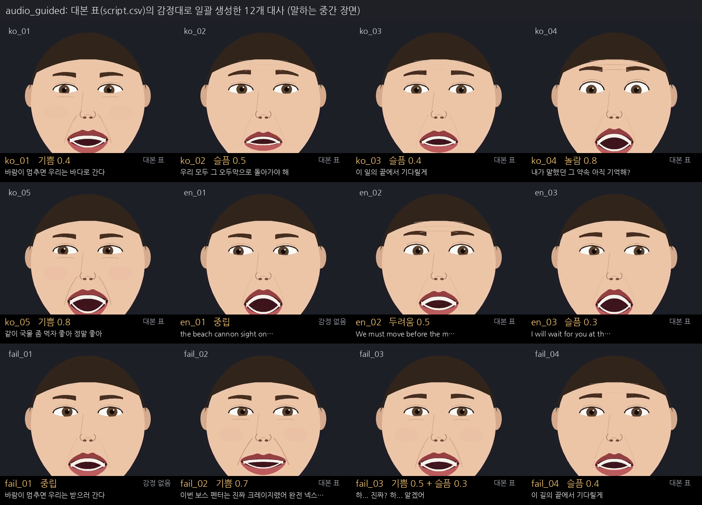
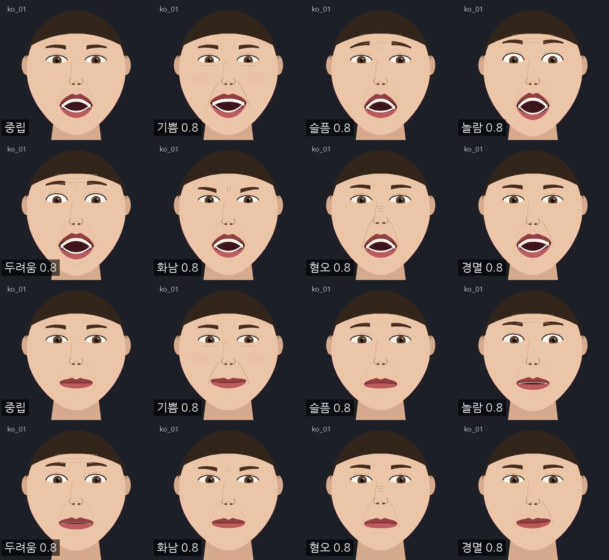
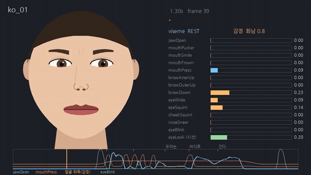
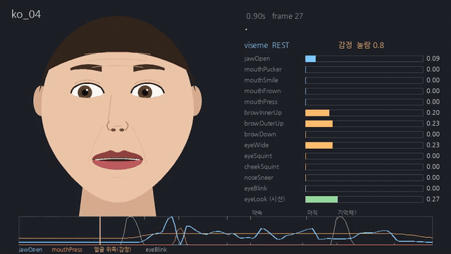
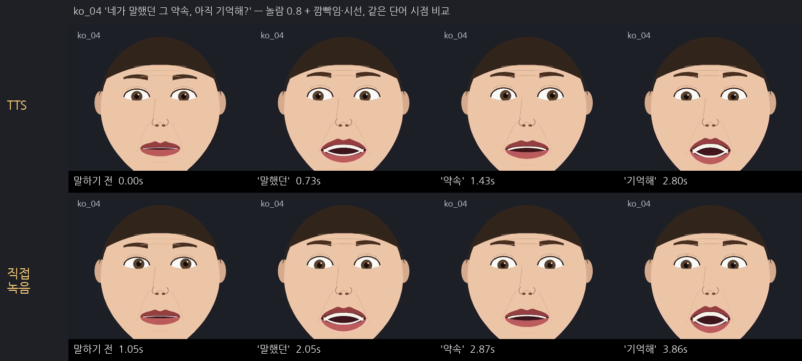

# 감정 레이어와 생기 레이어 (2차 1단계)

음성에서 만든 입 움직임(1차)에, 사람이 주는 **감정 가이드**와 **생기 레이어**(눈 깜빡임, 시선)를 더해 얼굴 전체를 움직인다.

```
입 레이어 (1차: 음성 → 발음)      → 턱, 입술
감정 레이어 (가이드 → FACS 표정)   → 눈썹, 눈꺼풀, 볼, 코, 입꼬리
생기 레이어 (규칙)                 → 눈 깜빡임, 눈동자 시선
                ↓ 합치기 (입술 닫힘은 덮어쓰지 않음)
ARKit 52 JSON (최종값 + 레이어별 값)
```

```bash
# 대본 표(samples/script.csv)의 감정대로 폴더 전체를 일괄 생성 + 한 장으로 모아 보기
python -m src.cli samples/audio --life --out outputs/audio_guided
python -m src.contact_sheet outputs/audio_guided
# 감정 하나를 직접 지정 (대본 표보다 우선)
python -m src.cli samples/audio/ko_01.wav --emotion "화남:0.6" --life
# 두 감정 섞기
python -m src.cli samples/audio/ko_01.wav --emotion "슬픔:0.5+화남:0.3" --life
# 같은 음성을 감정 8가지로 만들어 한 화면에 비교 → outputs/emotion_demo/
python -m src.emotion_demo samples/audio/ko_01.wav
```

`--no-emotion`을 주면 대본 표의 감정을 쓰지 않아 1차와 같은 결과가 나온다 (녹음 12개 커브 완전 일치 확인).

## 0. 감정을 어디서 넣고, 어디에 남기나

### 넣는 곳: 대본 표가 기본

게임 회사는 대사를 대본 표(스프레드시트, 대사 DB)로 관리하고, 각 줄에 연기 지시가 함께 적힌다.
그래서 **`samples/script.csv`의 `emotion` 열을 기본 입력**으로 한다. 폴더째 돌리면 대사마다 다른 감정이 적용된다.

```csv
id,lang,text,emotion,note
ko_04,ko,"네가 말했던 그 약속, 아직 기억해?",놀람:0.8,감정 초안: 뜻밖에 약속을 꺼내는 물음
fail_03,ko,"하하, 진짜? …하아, 알겠어.",기쁨:0.5+슬픔:0.3,웃음과 한숨. 감정 초안: 웃다가 체념
en_01,en,The birch canoe slid on the smooth planks.,,감정 초안: 없음 (중립 서술)
```

| 우선순위 | 입력 | 용도 |
|---|---|---|
| 1 | `--emotion "놀람:0.8"` | 한 번 시험해 볼 때 (대본 표를 덮어씀) |
| 2 | 대본 표 `emotion` 열 | 기본. 대량 처리 |
| - | `--no-emotion` | 대본 표의 감정을 끔 (1차 측정 재현용) |

현재 12줄의 감정은 **초안**이다. 대사 내용을 보고 정했고, 이유는 `note` 열에 적었다. 연출 의도에 맞게 고치면 된다.

### 남기는 곳

| 위치 | 내용 |
|---|---|
| JSON `meta.emotion` | `guide`(받은 원문), `source`(`script`/`option`/`disabled`/`none`), `parts`(감정별 강도), `label` |
| JSON `meta.life_layer` | 깜빡임·시선 레이어를 켰는지 |
| JSON `layers` | 입·감정·생기 레이어별 값 (합치기 전) |
| `summary.csv` | 대사별 `emotion`, `emotion_source`, `life` 열 |

`source`가 있어서, 결과 파일만 보고도 감정이 대본 표에서 왔는지 옵션으로 덮어쓴 것인지 알 수 있다.

### 일괄 처리 결과 (녹음 12줄, 대본 표 그대로)



- 감정 열이 빈 en_01, fail_01은 "감정 없음"으로 표시된다.
- 입 지표(ko_01 1.49, ko_05 3.26프레임, 입 닫힘 적중)는 감정 없이 만든 1차 결과와 같다.
- 강도 0.3~0.5 초안은 표정이 은은하다. 대사별로 강도를 조절하는 것은 대본 표에서 한다.

### 다음 단계

- **구간별 가이드:** "기억해?에서만 놀람 1.0"처럼 단어 단위로 감정 바꾸기
- **LLM 초안:** 대사 문장을 읽고 감정 열을 미리 채우고, 사람은 확인·수정만 하기
- **녹음 페이지 연동:** 녹음할 때 감정을 같이 골라 대본 표에 저장



위 두 줄은 말하는 중(4.6초, "바다로"의 ㅏ), 아래 두 줄은 말이 끝난 뒤(6.2초)다.
영상: [ko_01_emotions.mp4](../outputs/showcase/ko_01_emotions.mp4) · 화남 하나만 크게: [ko_01_anger_preview.mp4](../outputs/showcase/ko_01_anger_preview.mp4)

| 화남 0.8 (ko_01) | 놀람 0.8 (ko_04) |
|---|---|
|  |  |

놀람 영상: [ko_04_surprise_preview.mp4](../outputs/showcase/ko_04_surprise_preview.mp4)
(`python -m src.cli samples/audio/ko_04.wav --emotion "놀람:0.8" --life`)

### 같은 가이드, 다른 음성 (TTS vs 직접 녹음)



- 같은 가이드를 주면 **표정(눈썹·눈)은 같고, 입은 각 음성의 발음을 따른다.** 감정 레이어와 입 레이어가 독립적으로 동작한다는 확인이다.
- "약속"에서 직접 녹음은 입이 거의 닫혀 있고 TTS는 더 벌어져 있다. 발음 차이가 그대로 입에 반영된 것이다.
- 깜빡임 시점은 두 음성이 다르다. 말 시작 직전 깜빡임이 각 음성의 말 시작 시각을 따르기 때문이다.
- 영상(TTS → 직접 녹음 순서): [ko_04_surprise_tts_vs_voice.mp4](../outputs/showcase/ko_04_surprise_tts_vs_voice.mp4)

## 1. 감정 → ARKit: 어디서 가져왔나

**ARKit 52 자체에는 감정 프리셋이 없다.** Apple 문서는 52개 계수의 의미만 정의하고, 감정과의 연결은 개발자에게 맡긴다.
그래서 두 단계의 연구 자료를 이었다.

```
감정 ──①──> FACS 근육 동작(AU) 조합 ──②──> ARKit 채널 ──③──> 값 (강도·타이밍)
```

| 단계 | 근거 | 성격 |
|---|---|---|
| ① 감정 → AU 조합 | FACS 기본 감정 표 (Ekman 계열, EMFACS/FACSAID) | 심리학 연구. 출처마다 일부 차이 |
| ② AU → ARKit 채널 | Melinda Ozel의 ARKit-FACS 치트시트, miniface.org | 커뮤니티 정리. Apple 공식 아님 |
| ③ 강도·타이밍 | 이 프로젝트의 설계 (`config/emotion.json`) | 튜닝 대상 |

학습이 필요한 문제가 아니라 **값을 설계하고 다듬는 문제**다. 1차에서 입모양 값을 설정 파일로 다룬 것과 같다.

### 프리셋 (기본 감정, 최대 표정 기준 값)

| 감정 | AU | ARKit 값 |
|---|---|---|
| 중립 | - | - |
| 기쁨 | 6 + 12 | cheekSquint 0.6, mouthSmile 0.8 |
| 슬픔 | 1 + 4 + 15 | browInnerUp 0.8, browDown 0.3, mouthFrown 0.6 |
| 놀람 | 1 + 2 + 5 + 26 | browInnerUp 0.7, browOuterUp 0.8, eyeWide 0.8, jawOpen 0.3 |
| 두려움 | 1 + 2 + 4 + 5 + 7 + 20 + 26 | browInnerUp 0.8, browOuterUp 0.5, browDown 0.3, eyeWide 0.8, eyeSquint 0.2, mouthStretch 0.5, jawOpen 0.2 |
| 화남 | 4 + 5 + 7 + 23 | browDown 0.8, eyeWide 0.3, eyeSquint 0.5, mouthPress 0.3 |
| 혐오 | 9 + 15 + 17 | noseSneer 0.7, mouthFrown 0.4, mouthShrugUpper 0.4 |
| 경멸 | 한쪽 12 또는 14 | mouthSmileLeft 0.6, mouthDimpleLeft 0.6 (왼쪽만) |

### 근사한 부분

| 부분 | 문제 | 처리 |
|---|---|---|
| 화남의 AU23 (입술 조임) | ARKit에 딱 맞는 모양이 없음 | mouthPress로 근사 |
| 혐오의 AU17 (턱 올림) | 자료에 따라 mouthShrugUpper 또는 mouthShrugLower | Ozel 치트시트를 따라 mouthShrugUpper |
| 경멸 | 기본 감정 중 정의가 가장 불분명 | 한쪽 입꼬리. 출처마다 다름 |
| AU 조합 | 두려움·혐오는 출처마다 조합이 조금씩 다름 | Wikipedia FACS 감정 표를 따름 |

## 2. 강도와 타이밍

| 설정 | 값 | 이유 |
|---|---|---|
| 말하는 중 배율 (`speech_scale`) | 0.6 | 연구의 감정 원형은 사진용 최대 표정이라, 말하는 중에 그대로 쓰면 과장된다 (FACS 강도 C 정도) |
| 기본 수준 (`rest_level`) | 0.6 | 말하기 전후에도 감정이 남아 있다. 말하는 동안 1.0까지 강해진다 |
| 올라가는 시간 / 내려가는 시간 | 0.35초 / 0.5초 | 말 시작 0.2초 전부터 올라간다 |

## 3. 입과 합치는 규칙

| 부위 | 규칙 |
|---|---|
| 눈썹, 눈, 볼, 코 | 감정 값을 그대로 쓴다 (입 레이어에는 값이 없다) |
| 입 주변 | 말하는 동안에는 발음이 우선이라 감정을 0.8배로 줄여 더한다. 말하지 않을 때는 그대로 |
| 입술이 닫힌 순간 (ㅁ ㅂ ㅍ) | 감정이 입을 벌리거나(jawOpen) 옆으로 당기지(smile, stretch) 못한다 |
| 오므리는 발음 (ㅜ ㅗ) | 감정의 웃음·당김을 오므림 정도만큼 줄인다 (반대 방향 근육) |

JSON에는 최종 값(`curves`)과 함께 **레이어별 값(`layers.mouth`, `layers.emotion`, `layers.life`)**을 따로 남긴다.
애니메이터가 "감정만 약하게" 같은 수정을 할 수 있게 하기 위해서다.

## 3-1. 생기 레이어 (눈 깜빡임, 시선)

음성과 감정 가이드에는 눈의 움직임 정보가 없다. 눈이 멈춰 있으면 감정이 있어도 인형처럼 보이므로, 사람의 일반적인 패턴을 규칙으로 넣었다 (`src/life.py`, `config/life.json`).

| 항목 | 규칙 |
|---|---|
| 눈 깜빡임 | 평균 3.0초(표준편차 1.0초) 간격, 최소 1.2초. 말을 시작하기 0.25초 전에 한 번. 감는 데 0.07초, 머묾 0.03초, 뜨는 데 0.13초 |
| 시선 | 가로 ±0.35, 세로 ±0.2 범위의 목표점으로 0.05초 만에 옮겨 가서 0.6~2초 머문다 |
| 재현성 | 파일 이름으로 만든 고정 난수라 같은 파일은 항상 같은 결과. 감정이 달라도 깜빡임 시점이 같아 감정끼리 비교하기 쉽다 |

이 레이어는 eyeBlink, eyeLook 채널만 건드린다. 입 결과는 바뀌지 않는다 (5장 검증).
1차 결과의 재현성을 지키기 위해 `--life`를 줄 때만 켠다.

## 4. 튜닝 기록

| 시도 | 문제 | 수정 |
|---|---|---|
| 기본 수준 0.35 | 말이 끝나면 모든 감정이 중립처럼 보임 | 0.6으로 올림. 말하기 전부터 감정이 있도록 곡선 변경 |
| 입 주변 감정 0.6배를 항상 적용 | 말하는 중 배율과 겹쳐 기쁨의 웃음이 거의 안 보임 | 0.8배로 올리고, 말하는 동안에만 적용 |
| 경멸 0.4 | 한쪽 입꼬리가 거의 안 보임 | 0.6으로 올림 |
| 2D 미리보기의 눈썹 반응 | 화남 값이 맞게 들어가도 그림에서 6픽셀만 움직임 | 미리보기 그림만 반응을 키움 (데이터 값은 그대로) |
| 첫 2D 얼굴 (동그라미 눈) | 눈꺼풀이 없어 감정이 약해 보이고, 눈동자·코가 움직이지 않음 | **얼굴을 새로 그림** (아래 4-1). 눈동자가 안 움직였던 진짜 원인은 데이터에 시선·깜빡임 값이 없었던 것이라 생기 레이어를 추가 |
| 깜빡임 평균 3.5초 | 6.9초 대사에 한 번뿐이라 눈이 멈춰 보임 | 3.0초로 줄임 (사람 범위 2~5초 안) |

## 4-1. 2D 얼굴 (`src/face2d.py`)

시연 자료에서는 JSON 값의 변화가 2D 화면에서 잘 보여야 한다. 첫 얼굴은 눈이 동그라미라 눈꺼풀 변화가 보이지 않았다. 사람 얼굴 형태로 다시 그렸다.

| 부위 | 그리는 방식 | 반응하는 채널 |
|---|---|---|
| 눈 | 윗눈꺼풀·아랫눈꺼풀을 따로 그린 아몬드 모양, 쌍꺼풀 선, 속눈썹 선 | eyeWide(크게), eyeSquint·cheekSquint(가늘게, 아랫눈꺼풀이 올라옴), eyeBlink(감음) |
| 눈동자 | 흰자 모양으로 잘라서 그림 | eyeLookIn/Out/Up/Down |
| 눈썹 | 두께가 있는 눈썹. 안쪽과 바깥쪽이 따로 움직이고, 내리면 미간 쪽으로 모임 | browInnerUp, browOuterUp, browDown |
| 이마·미간 | 눈썹을 올리면 가로 주름, 내리면 미간 세로 주름 | 위와 같음 |
| 코 | 콧방울과 콧구멍. 찡그리면 올라가고 벌어지며 콧등 주름 | noseSneer |
| 볼 | 볼이 올라가면 눈 밑 볼살 선과 홍조 | cheekSquint, mouthSmile |
| 팔자 주름 | 콧방울 옆에서 입꼬리 바깥으로. 입꼬리를 따라 움직이고 웃거나 찡그리면 진해짐 | mouthSmile, noseSneer, mouthUpperUp |
| 입 | 좌우 입꼬리를 따로, 윗입술 굴곡, 위아래 치아, 턱 주름 | 입 채널 전체 (좌우 별도) |
| 턱선 | 턱을 벌리면 얼굴 윤곽의 턱 부분이 같이 내려감 | jawOpen |

선을 매끄럽게 하려고 두 배 크기로 그린 뒤 줄인다. 그림의 반응 크기(픽셀)는 "값의 변화가 잘 보이도록" 정한 것이고 데이터 값과는 무관하다.

## 5. 검증: 감정을 얹어도 입은 그대로인가

ko_01, ko_05 직접 녹음을 감정 8가지로 만들어 1차 라벨로 채점했다 (감정 강도 0.8).
생기 레이어(`--life`)를 켠 뒤에도 다시 채점했고, 입 지표(모음 시작 오차, 입 닫힘 적중, 잘못 닫힘)는 모두 같았다.

| 감정 | 모음 시작 오차 (ko_01 / ko_05) | 입 닫힘 적중 | 잘못 닫힘 | 무음인데 입 열림 (ko_01 / ko_05) |
|---|---|---|---|---|
| 중립 | 1.49 / 3.26 | 5/6, 2/2 | 1, 1 | 1 / 3 |
| 기쁨, 슬픔, 화남, 혐오, 경멸 | 같음 | 같음 | 같음 | 1 / 3 |
| 두려움 | 같음 | 같음 | 같음 | 2 / 4 |
| 놀람 | 같음 | 같음 | 같음 | **11 / 13** |

- **입 닫힘은 모든 감정에서 그대로다.** 놀람·두려움처럼 턱을 벌리는 감정도 ㅁ/ㅂ/ㅍ에서는 입이 닫힌다 (닫힘 규칙이 동작).
- 모음 시작 오차가 같은 것은 이 지표가 커브가 아니라 음소 구간을 재기 때문이다 (1차 검수에서 확인한 한계).

### 값의 검증: "무음인데 입 열림" 지표의 전제가 깨졌다

놀람에서 이 수치가 1 → 11로 늘었다. 놀란 표정은 말하지 않을 때도 입을 살짝 벌리고 있어서, **의도한 표현을 지표가 오류로 센다.**
이 지표는 "말하지 않으면 입이 닫혀 있어야 한다"는 1차의 전제로 만들었다. 감정이 들어온 뒤로는
"감정이 없을 때의 무음 구간"에만 쓰거나, 감정 레이어의 jawOpen을 뺀 값으로 재야 한다.

## 6. 한계와 다음 단계

- **감정 표정은 여전히 고정돼 있다.** 깜빡임·시선은 움직이지만, 감정 곡선이 평평한 사다리꼴이라 눈썹·입꼬리는 말하는 동안 변하지 않는다
  (`outputs/showcase/ko_01_anger_curves.png`). → 강조 레이어(목소리가 높고 센 곳에서 눈썹이 올라가는 등)가 다음 단계.
- 고개 움직임이 없다 (ARKit 52 밖의 머리 회전 값이 필요).
- **감정이 대사 전체에 하나다.** "마지막 단어에서 비꼬듯이" 같은 구간별 가이드는 아직 없다.
- **감정이 잘 전달되는지 재지 않았다.** 다음 평가: 감정을 알려 주지 않고 영상을 보여 준 뒤 몇 명에게 맞히게 한다.
- **2D 미리보기는 대략적인 확인용이다.** 실제 캐릭터에서는 아티스트가 만든 모양의 크기를 따르므로, 캐릭터에 붙인 뒤 값을 다시 맞춰야 한다.
- 기본 감정 7개만 있다. 복합 표정(Du et al. 2014의 21개)은 프리셋 두 개를 섞는 방식으로 이미 표현할 수 있지만 검증하지 않았다.

## 출처

- [Wikipedia: Facial Action Coding System](https://en.wikipedia.org/wiki/Facial_Action_Coding_System) (감정별 AU 표)
- [Melinda Ozel: ARKit to FACS Cheat Sheet](https://melindaozel.com/arkit-to-facs-cheat-sheet/)
- [miniface: ARKit 52 Blendshapes](https://miniface.org/arkit-blendshapes)
- [Apple: ARFaceAnchor blendShapes](https://developer.apple.com/documentation/arkit/arfaceanchor/blendshapes.md)
- [Du, Tao, Martinez (2014). Compound facial expressions of emotion. PNAS](https://www.pnas.org/doi/abs/10.1073/pnas.1322355111)
